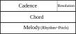

English | [日本語](README.ja.md)

# What is this
A tool to help with composing music.
Try it [here](https://hyranno.github.io/auto_compose/).
It generates a musical phrase automatically from various parameters.
It is based on Western music theory, but simplifies it and may contain mistakes.
Use it when you want to compose but starting from nothing is hard.


# Copyright
The copyright of this program belongs to the author (hyranno), and it is available under the MIT License.
This program does not use machine learning, so there are no copyright issues with training datasets.

Tunes output by the program as they are may not be protected by copyright.
They are probably treated like works created by AI, but ask someone familiar with the law.

Works arranged or composed from the output of the program are copyrighted by the people who arranged or composed them.


# Usage
The top of the page holds the parameter settings, the middle the piano roll, and the bottom the output panel.

## Parameter settings
Set the parameters used for the generation.
See below for the meaning of each parameter.
After changing the parameters, press the generate button to generate the tune again.

Only some of the parameters have input forms.
To set all the parameters, load a JSON file.
Examples are in the `resources` folder, and the format (JSON Schema) is in the `schemas` folder.
Press the save as file button to save the settings to a file.
If a loaded file has an error, it is not applied and the error is shown.

## Piano roll
A piano roll with the pitch on the vertical axis and the time on the horizontal axis.
The numbers on the left are MIDI note numbers.
The colors at the top show the cadence: blue is Tonic, yellow Subdominant and red Dominant.

Pink shows the key.
Notes in the scale are white, and notes outside it are gray.
Orange shows the notes of the chord, and the darker part is its root.
Blue shows the notes of the melody.

## Output panel
Listen to the generated tune with the play button, or export it as a MIDI file.
The MIDI file is meant to be loaded and edited in a DAW or other music software.


## Parameters overview
An overview of the parameters that have input forms.
The goal of this section is just to get you started.
To understand the parameters in detail, see the algorithm section.

* Common
    + seed ... The seed of the random numbers, an integer from 0 to 4294967295.
        Changing it gives a different tune of a similar feel. The value itself has no meaning.
        Each generator also has a seed field: when it is filled in, it replaces the seed for that
        generator only, so that one layer can be changed while the others are kept.
* Scale
    + key ... The key note.
    + tones ... The scale, as pitches relative to the key note. The Major/minor buttons fill it in.
* Resolution ... How the four measures end.
    Choose Half or Plagal to make the tune feel like it continues, or Perfect and the like to make it feel finished.
* Time Measure ... The time signature.
* Cadence
    + duration ... How often the chord changes. 2 or 4 suit 4/4 time, and 3 suits 3/4 time.
* Rhythm
    + max beat division depth ... The shortest note, a 2^x-th note.
    + p_branch edges ... How much the notes are divided.
        A smaller left value gives more short notes, and a larger right value gives fewer long notes.
    + p_note_on edges ... How often notes become rests. Smaller values give more rests.
* Pitch
    + abs_pitch_factor edges ... Larger values make notes far from the key note more likely.
    + rel_pitch_factor edges ... Larger values make notes far from the previous note more likely.
    + factor_in_scale ... Larger values make notes in the scale more likely.
    + factor_in_chord ... Larger values make notes in the chord more likely.
    + rhythm_exponent_factor ... Larger values make the length of a note affect the choice of its pitch more.


# Structure and development
* `crates/auto-composer` ... The Rust library with the generation logic.
* `crates/auto-composer-wasm` ... The WebAssembly bindings (built with wasm-pack).
* `web` ... The web page using the bindings (Vite + Solid + TypeScript).
* `resources` ... The default and example parameters. `schemas` is their format, generated from the Rust types.
* `fixtures` ... Test data that pins the generated output (golden fixtures).

The development environment is a devcontainer (`.devcontainer`). The main commands:

```sh
cargo test --all-features              # Rust tests
cd web && npm run wasm && npm install  # once (builds the wasm package first)
npm run dev                            # the web page (http://localhost:5173)
```

See `doc/dev/` for details. The changes are listed in `CHANGELOG.md`.


# Algorithm
This section explains how the program generates a phrase.
Read it together with the source code to understand the algorithm and the parameters in detail.
It is also about how music theory is implemented,
but the terms and the like may contain mistakes.
Some parts assume knowledge of stochastic processes such as Markov chains.

A generated phrase consists of a first half and a second half: the first half is generated,
then changed to make the second half (the variant).

The generation has several stages of different levels of abstraction: cadence, chord, then the rhythm and pitch of the melody.



## The first half
This part generates the first half of the phrase.
In the source code, `crates/auto-composer/src/generator/tune.rs` is the top level. It reads `generator::tune::Parameters` from JSON.

### Cadence
While a chord is a concrete set of notes,
the function or character of a chord is called its harmonic function,
and a sequence of harmonic functions is called a cadence.
A harmonic function is Tonic, Dominant or Subdominant,
and each one more or less determines which can come next.
This program treats the cadence as a time-homogeneous finite-state Markov chain on these three states.
The end of the cadence, however, is determined by the resolution.

Given the current state and the end pattern, the probability of each next state is its transition
probability times the probability of reaching the start of the end pattern from it in the remaining steps.
This program picks the next state (cadence) from this conditional distribution.
When the end pattern cannot be reached, the condition is dropped.

### Chord
A chord consists of a root and tones, and depends on the cadence.
Some chords should depend on the resolution, but this is ignored because it would complicate the implementation.
Inversions, which move some tones by an octave, are not handled either.

The root is the degree of the scale from the key note.
Since each harmonic function more or less determines the root, the root is drawn from a memoryless source set for each harmonic function.
The tones are degrees of the scale from the root; for example, (0, 2, 4) is a triad.
I do not know the theory of the tones well, so they are drawn from a memoryless source.

### Rhythm
I could not find music theory about rhythm at hand, so the rhythm uses an original method.
With a beat of length 1, each beat is divided in half recursively at random,
and each resulting note becomes a rest at random.
The probabilities of dividing and of not becoming a rest depend on the length of the note,
and follow smoothsteps with the edges of p_branch and p_note_on.
Notes are not divided beyond the max beat division depth.

### Pitch
Each note from the rhythm gets a pitch, which makes the melody.
The pitch is a Markov chain that depends on the scale, the chord and the rhythm.
Note that it is not time-homogeneous, since it depends on the chord and the rhythm, which change over time.
Some pitches should depend on the resolution, but this is ignored because it would complicate the implementation.

The pitch is drawn from the candidates by their weights, and the weight of each candidate is:

weight = (absFactor * relFactor * scaleFactor * chordFactor) ^ (1 + rhythmExponent)

* absFactor ... Depends on the distance from the key note, by a smoothstep with the edges of abs_pitch_factor.
* relFactor ... Depends on the distance from the previous pitch, by a smoothstep with the edges of rel_pitch_factor.
* scaleFactor ... factor_in_scale for a note in the scale, 1 otherwise.
* chordFactor ... factor_in_chord for a note in the chord, 1 otherwise.
* rhythmExponent ... Lets short notes be adventurous and keeps long notes safe.
    rhythmExponent = rhythm_exponent_factor * the length of the note

## The variant
This part arranges a given tune into another.
The parameters set the timespan to arrange and the stage (cadence, chord, pitch or rhythm) to change.
In the source code, `crates/auto-composer/src/generator/variant.rs` is the top level. It reads `generator::variant::Parameters` from JSON.

### Changing the cadence
The cadence within the timespan is generated again by the Markov chain, with the conditional distribution given the states before and after it.
The chords and pitches, which depend on the cadence, are generated again as well.

### Changing the chord
The chords within the timespan are generated again with new random numbers.
The pitches, which depend on the chords, are generated again as well.

### Changing the pitch
The pitches within the timespan are generated again by the Markov chain,
with the conditional distribution given the pitches before and after it.
As mentioned above, the pitch depends on the rhythm and the chord and is not time-homogeneous,
so its conditional distribution is hard to compute directly.
Instead, the conditional distribution is computed with a time-homogeneous finite-state Markov chain without the rhythm and the chord,
and the effect of the rhythm and the chord is added only to the distribution of the next note.

### Changing the rhythm
The notes within the timespan are divided or merged at random, and whether each is a rest is drawn again.
The pitches of the changed notes are generated again.
